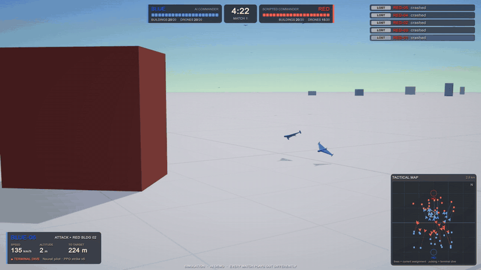
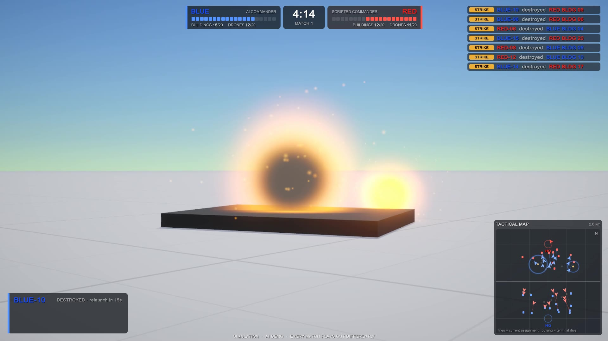
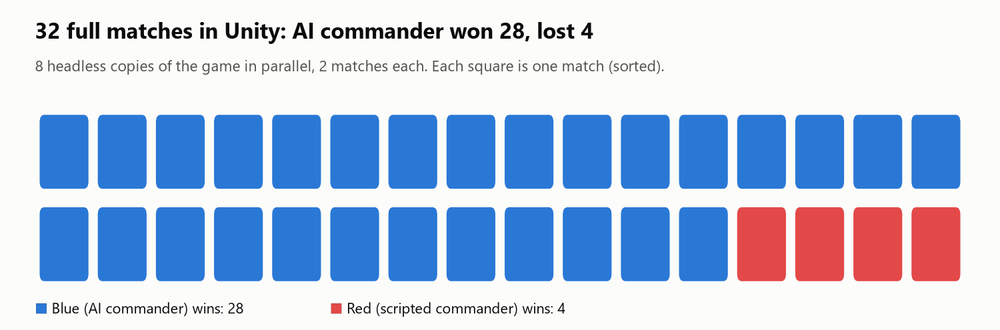
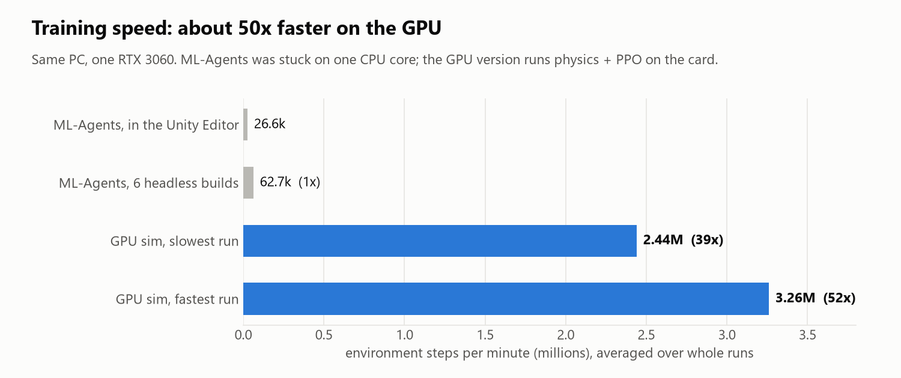
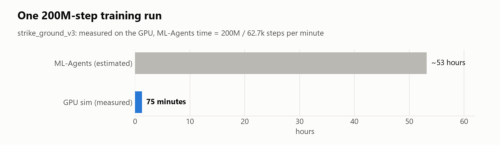
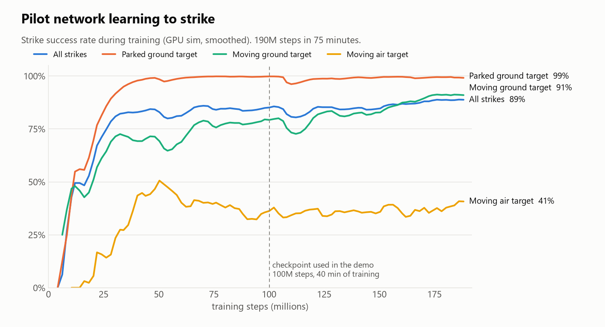
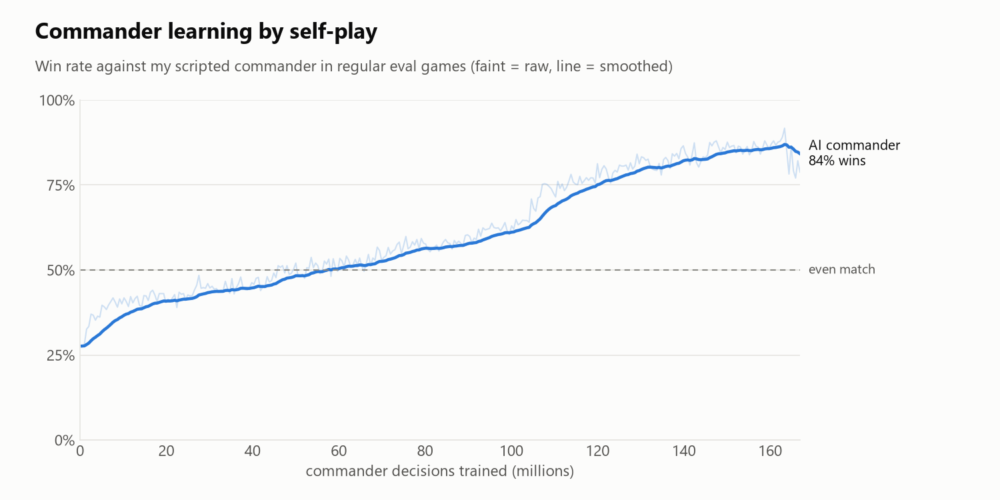

# Swarmfront

20 vs 20 fixed-wing drones. Every pilot is a neural network. One side is run by an AI commander I trained with self-play, the other by a scripted commander I wrote. Nobody touches the controls, you just watch.

I'm a big Arma 3 fan, and I always wanted to see what a battle looks like when every unit AND the commander are AI. So I built it in Unity. It's a simulation and a game AI / reinforcement learning sandbox, nothing more. I don't endorse violence, there's no real hardware here and no real-world targets.

## Watch the demo

*Click for the full 2:07 match with sound.* Blue (the AI commander) takes out all 20 Red buildings in 1:31. This is one match recorded live in the engine. Every match plays out differently, so scroll down for the numbers over 32 matches.

## Play it yourself

1. Go to [**Releases**](../../releases/latest) and download `Swarmfront-Windows-x64.zip` (about 55 MB)
2. Unzip it anywhere and run `Swarmfront.exe`
3. If Windows says "Windows protected your PC", click **More info** then **Run anyway** (the exe isn't signed)

It starts on the cinematic camera and matches loop forever. Needs Windows 10/11 64-bit and a DirectX 12 GPU. I tested it on an RTX 3060.

| Key | What it does |
|---|---|
| K | cinematic camera on/off |
| C | jump to the next drone |
| V | overview |
| F | walk around as the commander |
| N | tactical map on/off |
| H | hide the HUD |

## What you're looking at

- **The arena.** Two bases 2 km apart. Each side has 20 drones and 20 buildings. You win by destroying all of the enemy's buildings, or by having more standing when the 5 minute clock runs out.
- **The pilots.** Every drone is flown by a neural network trained with PPO. No autopilot, no scripted flying, no waypoints handed to it. It decides 50 times a second and flies the terminal dive itself. The flight model has lift, drag, stall, motor lag and wind.
- **The commanders.** Every 2 seconds the commander looks at the whole battlefield and gives each drone a job: attack a building, intercept an enemy drone, or defend. Blue's commander is a network trained by self-play. Red's is a rule-based one I wrote by hand.
- **The tactical map** (bottom right) shows every drone, where it's heading and the target its commander assigned. The lines pulse when a drone is in its final dive.

## Does the AI actually win?

A demo video can lie, so I ran 32 full matches headless: 8 copies of the game in parallel, 2 matches each, at 4x speed. The AI commander won 28 and lost 4. That's 88%. Matches lasted about 2 minutes.

So the scripted commander still wins about 1 in 8. You might see it happen if you leave the game running.

## Why training went 50x faster on the GPU

This is the part I'm most proud of.

I started with Unity ML-Agents. Even with 6 headless builds and 384 drones it topped out at about 63k steps per minute on my PC. I profiled it and the problem wasn't Unity and it wasn't the GPU. The Python trainer was pinned at 100% of one CPU core, each Unity player sat at 2% and the GPU was 3% busy. Every single decision had to go through one Python process.

So I ported the flight physics, the missions and PPO itself to PyTorch and put everything on the GPU. Tens of thousands of drones fly at once as batched tensor math. Nothing gets shipped between processes anymore. Same RTX 3060, now 2.4 to 3.3 million steps per minute.

In real time that means a run that would take ML-Agents about 2 days finishes in 75 minutes. Instead of one experiment a day I could try an idea, look at it, fix the reward and run again before lunch.

Before trusting the GPU sim I checked it against Unity. I replayed a recorded 12 second flight and the max error was 6 mm in position and 0.04° in attitude. I also reused ML-Agents' own network classes and ONNX export, so a model trained on the GPU drops straight into Unity with no changes. The drones in the demo are running exactly that.

It's not free though. Every gameplay change now has to be made twice, once in C# and once in PyTorch. And the speed only shows up when you simulate thousands of drones at once. With a few hundred it's actually slow.

## Training graphs

**Pilots.** The strike pilot learning to hit parked targets, moving vehicles and moving aircraft. The demo uses the 100M step checkpoint, which took 40 minutes to train. Hitting a moving plane is still the hard one at around 40%, so that's next on my list.

**Commander.** The commander learned by playing against itself and against older copies of itself. Every so often it plays a set of eval games against my scripted commander. It starts at about 27% wins and ends up above 80%.

## Built with

Unity 6 (URP) · ML-Agents 4 · Unity Inference Engine · PyTorch · one RTX 3060

## What's next

Resources and economy, more unit types, bigger and real-world maps, and a variable number of units per side. The commander was designed to scale to that from the start.

If you work on game AI, simulation or RL and want to talk, reach out.

---

The training code and Unity project are private for now. This repo has the playable build, the demo video and the training charts. Charts are made from the actual TensorBoard logs with [`tools/make_charts.py`](tools/make_charts.py).
